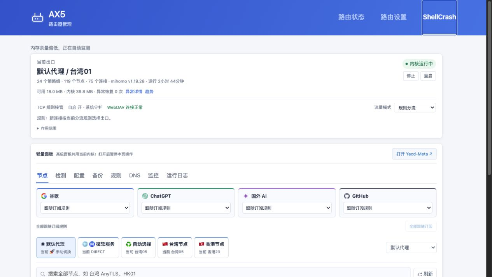
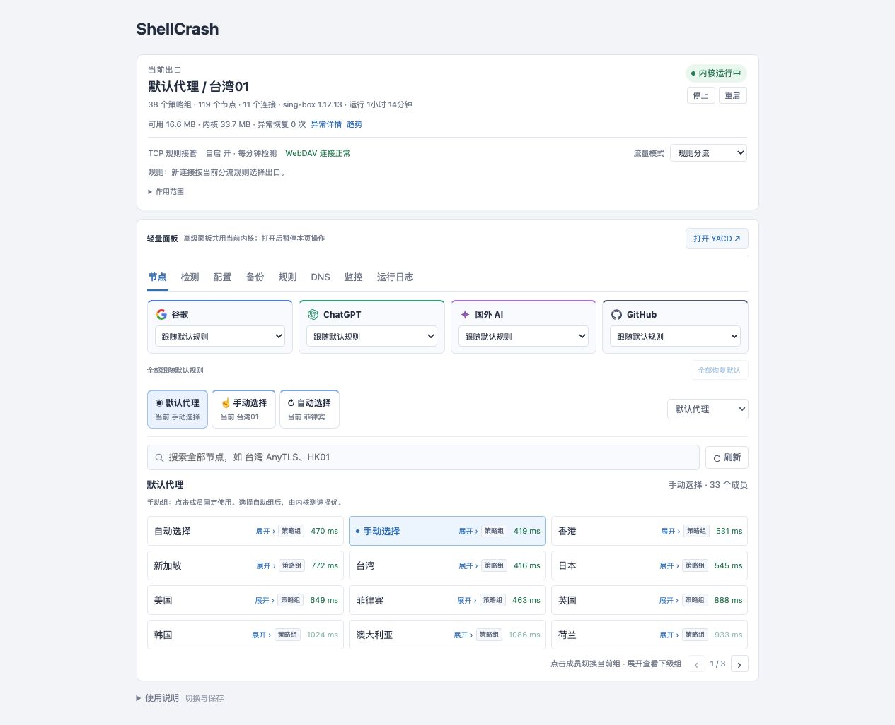
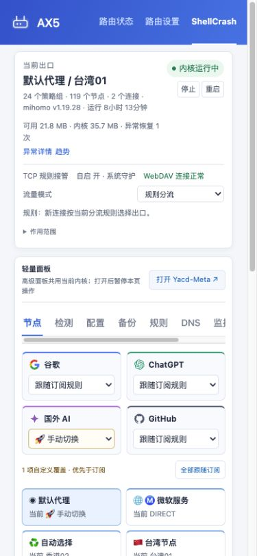
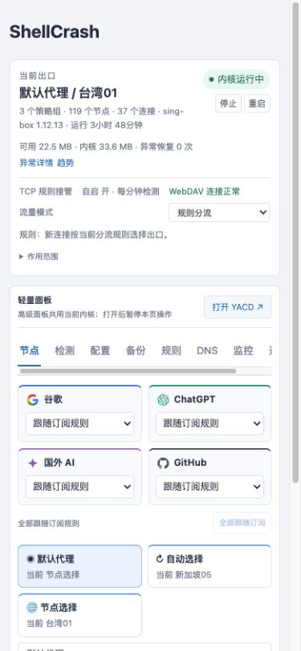

# ShellCrash Router Panel

在路由器原来的管理页里，用网页管理 ShellCrash：选节点、更新订阅、设置分流和 DNS，查看内存与日志，需要时再打开高级面板。

**1.0 正式版**，支持 Redmi AX5 和 K2P / Padavan。选好对应机型的安装包，按向导安装；已经在用面板的设备走[更新入口](docs/DEPLOYMENT.md#已有面板怎么更新)。

[下载1.0](https://github.com/wcbspp/ShellCrash-Router-Panel/releases/tag/v1.0.0) · [安装说明](docs/DEPLOYMENT.md) · [备份与恢复](docs/BACKUP.md) · [页面使用说明](docs/USAGE.md)

## 先确认设备

| | Redmi AX5 | K2P |
| --- | --- | --- |
| 验证过的硬件 | RA67，ARMv7 | MT7621，16 MB 闪存 |
| 验证过的固件 | 小米原厂 **1.0.105 稳定版** | Padavan **4.4.198.9-100_20220804** |
| 支持的内核 | sing-box mini 1.12.13、Mihomo 1.19.28 | sing-box mini 1.12.13 |
| 页面入口 | 小米后台顶部 **ShellCrash** | 高级设置 → **ShellCrash** |
| 订阅 | 服务商直取，也保留 ShellCrash 转换方式 | 服务商直取、同源兼容下载 |
| 保存位置 | `/data/ShellCrash` | `/etc/storage/ShellCrash`，保存到 Storage |

**这不是固件，不会替你刷机或开启 SSH。** 其他型号、其他固件、K2P 32 MB 改版没有逐一验证。sing-box mini 不支持 SSR，换面板也不会增加内核没有的协议。

## 安装前准备

先把路由器固件和 SSH 准备好，再装面板。已运行下表固件的设备不必为了装面板重新刷机。

| 准备项 | 地址与说明 |
| --- | --- |
| ShellCrash 上游 | [juewuy/ShellCrash](https://github.com/juewuy/ShellCrash)。安装包带有注明来源的 **1.9.4release** 工具，无需先重复装一遍 ShellCrash |
| AX5 开启 SSH | [XMiR-Patcher 作者仓库](https://github.com/openwrt-xiaomi/xmir-patcher)，按项目说明操作；这是社区工具，不是小米官方解锁服务 |
| AX5 配套固件 | [小米官方 1.0.105 下载](https://cdn.cnbj1.fds.api.mi-img.com/xiaoqiang/rom/ra67/miwifi_ra67_firmware_59980_1.0.105.bin) · [小米官方下载页](https://www.miwifi.com/miwifi_download.html)。型号为 **Redmi AX5 / RA67**，不要选成小米 AX1800 |
| K2P 配套固件 | [16 MB K2P 固件与校验文件](https://github.com/wcbspp/ShellCrash-Router-Panel/releases/tag/firmware-k2p-16m-4.4.198.9-100)。实机版本为 **4.4.198.9-100_20220804**；来源、文件选择和验证范围见[固件说明](docs/FIRMWARE.md#k2p) |
| 电脑 | **Python 3.9+、OpenSSH、浏览器**。macOS / Linux 直接运行；Windows 使用 WSL。路由器不用安装 Python 或 Node.js |
| 网络与账号 | 电脑连路由器局域网，SSH 已开启。AX5 通常用 `root`，K2P 通常用 `admin`；地址、用户名和端口以自己的设置为准 |
| 订阅或节点 | 自备可用订阅。K2P 首装接受兼容的 sing-box JSON 或 AnyTLS 链接；离线时准备本地节点文件 |

安装前保存固件配置，助手还会另存本次修改前的文件到电脑 `~/ShellCrash-backups/`。K2P 先关闭原“科学上网”插件的运行开关，保留配置，安装时退出其他管理页面。

安装器会核对固件接口、命令、空间和已有部署，缺条件会给出提示。[完整依赖与固件来源](docs/FIRMWARE.md)中列出了两机各自要求。

## 在线一键安装

**在电脑终端运行，不是在路由器 SSH 里运行：**

```sh
curl -fL https://raw.githubusercontent.com/wcbspp/ShellCrash-Router-Panel/v1.0.0/bootstrap.py -o shellcrash-install.py
python3 shellcrash-install.py
```

按提示选 AX5 或 K2P，再选安装、更新或只检查。助手核对下载包 SHA256 后才进入设备安装流程。密码由 SSH 自己询问，不必写进命令。

已知地址时也可直接指定；地址改过就填实际地址：

```sh
python3 shellcrash-install.py ax5 --router 192.168.31.1
python3 shellcrash-install.py k2p --router 192.168.123.1
```

自定义用户名和端口加 `--user`、`--port`，只检查加 `--check-only`。GitHub 下载不通时，从 [Releases](https://github.com/wcbspp/ShellCrash-Router-Panel/releases/tag/v1.0.0) 下载对应机型 `.tar.gz`，解压后运行 `python3 start.py`。macOS 也可双击 `Install.command`。

## 离线一键安装

先在**有网络的电脑**上准备，二选一：

```sh
python3 shellcrash-install.py ax5 --prepare-offline
python3 shellcrash-install.py k2p --prepare-offline
```

助手下载并分别校验面板和固定版本内核，生成 `shellcrash-router-panel-机型-offline-1.0.0` 文件夹。在已解压的安装包里，也可运行 `python3 start.py --prepare-offline`。

把**整个文件夹**带到连接路由器的电脑，进入文件夹运行：

```sh
python3 start.py
```

内核会自动从本地文件读取。K2P 离线首次安装还要带上本地节点文件，按提示填写路径，不要填订阅网址。离线安装不会为了获取内核和节点访问公网；高级面板和订阅额外资源另算。K2P 内核运行在 RAM，重启后的离线恢复需要另行准备，见[离线注意事项](docs/DEPLOYMENT.md#离线时要注意什么)。

## 实机页面

以下是统一版在两台设备上的实际页面。节点名、延迟、内存和运行时间是截图当时的状态，不是性能保证。

**AX5 · 小米原厂后台**



**K2P · 轻量面板**



<details>
<summary>手机页面</summary>




</details>

[更多截图与来源](docs/SCREENSHOTS.md)

## 页面与功能

### 主页：先看设备是否在正常工作

顶部显示当前出口、运行内核、节点与连接数量、运行时长、可用内存、自启动和守护状态。启动、停止、重启和流量模式都在这里；查看“异常详情”和内存趋势，可以分辨是网页断开还是核心确实发生过恢复。

手动停止会同时暂停自动恢复，守护不会立刻把它拉起来。切换直连、规则或全局模式后，用新连接观察结果，原有连接可能继续走先前出口。

### 节点与测速：按策略组选，分开看延迟

节点页读取内核里的真实策略组。选中组后可展开成员、搜索基础节点、切换固定节点或使用自动组；自动组由内核持续择优，关闭网页也会继续工作。Google、ChatGPT、国外 AI、GitHub 的常用网站分流可在页面上方分别指定出口，也可选择跟随订阅规则。

列表测速使用一次内核 HTTPS 测试，不再取三次平均。需要进一步判断时，按需分别测 **Ping** 和 **HTTPS**：Ping 看节点服务器的 ICMP 往返；HTTPS 看经节点访问测试站的整次请求，包含连接与 TLS 握手。两者分开展示，不把它们当成同一个延迟。部分服务器禁 ICMP，Ping 超时也可能正常代理。

### 检测：看网站连不上卡在哪一步

检测页检查常用网站的连接与 HTTPS 响应，并保留 DNS、连接超时、TLS 或 HTTP 返回等结果。先确认核心运行，再测目标；个别站点拒绝请求，不必马上认定整个节点不可用。

### 配置与订阅：更新节点，也保留本机设置

在配置页填写服务商地址，调整 User-Agent、节点过滤和下载方式，再执行更新。页面会区分当前已应用配置与下次更新准备使用的参数；修改输入框不等于已经更新节点。下载或内核校验失败时保留原配置。

AX5 支持服务商直取及 ShellCrash 的转换方式；使用转换服务时，对方会收到订阅地址。K2P 提供服务商直取和同地址的兼容下载，不提供第三方转换。兼容的完整 JSON 可保留订阅策略与规则，本机明确设置的 DNS、接管入口和额外域名覆盖另行保留。

### 备份与恢复：留好当前状态，再考虑回退

备份页可测试、保存、开启或关闭 WebDAV，查询最新完整备份和独立基础备份，也能导出本机应用。完整备份包含程序、当时配置、匹配内核和运行资源；单独导出的应用包不能代替全部组件。

恢复窗口会先检查组件，再做本机原生预检。符合当前开放的**同机型、同内核**条件后，查看计划并二次确认；连接断开后可查询同一任务结果。WebDAV 参数改过要重新测试，备份可能含节点密码，请私密保存。[备份与恢复步骤](docs/BACKUP.md)

### 规则与 DNS：看实际生效的内容

规则页显示内核当前使用的规则、策略组和连接。需要为某些网站另选出口时，使用常用网站分流或额外域名规则；“跟随订阅规则”会撤销这一项本地指定，让订阅继续决定出口。

DNS 页可查询和设置真实 DNS / Mix 及支持的 Fake IP 例外。不同内核的能力和字段不同，页面按当前内核显示。流量接管范围以设备与当前设置为准，全局 TCP 不等于全协议 VPN。[分流与接管说明](docs/DOMESTIC_BYPASS.md)

### 高级面板：展开看完整策略、规则和连接

顶部的“打开 YACD / Yacd-Meta”进入高级面板：**sing-box 使用 YACD，Mihomo 使用 Yacd-Meta**。可查看完整策略组、实时连接和规则，切换与轻量页共用同一个核心，不会另外启动一套代理。

高级面板按需下载到 RAM，重启后首次打开可能重新下载。打开后轻量页会暂停操作和测速；返回时重新读取核心选择，避免两边同时改。显示比例默认 90%，可调整并由浏览器记住。K2P 管理期间保持单一客户端，其他设备独立打开的面板仍可能操作同一核心。

### 监控与日志：留住出问题时的信息

可查看内存趋势、核心日志、操作记录和异常恢复情况，调整已有保护阈值并按需清理。先看报错再处理，不必一遇到网页慢就重启；清理内存也不会让小内存设备变成适合无限并发的机器。[更详细的页面用法](docs/USAGE.md)

## 几个容易弄混的地方

- **直连、规则、全局 TCP**只描述本机接管范围。全局 TCP 不等于全协议 VPN，不保证普通 UDP 和 IPv6 一并代理；切模式后用新连接判断。
- **K2P 不提供第三方订阅转换。** AX5 使用转换服务时，对方会收到订阅地址，请自行选择可信服务。
- **应用导出不等于完整恢复。** 完整备份包括程序、配置、匹配内核和运行资源；恢复前检查机型、内核、组件与设备条件，再要求二次确认。
- **小内存设备不适合无限加压。** AX5 实测16路连接半小时；K2P加到23路后触及测试安全余量，主动停流。不能当作64路持续高负载通过。连续24小时和部分业务边界仍未覆盖，见[1.0使用范围](docs/RELEASE_1.0.md)。

## 开发与来源

公共页面和脚本在 `shared/`，固件接口在 `profiles/`。构建后生成各自安装包，路由器不运行模板编译器。开发测试需要 Node.js 和 `lupa==2.8`，这些不是路由器安装依赖。

```sh
python3 -m pip install lupa==2.8
python3 tools/build.py all
python3 tools/check_baseline.py
python3 -m unittest discover -s tests
python3 tools/run_tests.py all
python3 tools/package.py
```

基于 [ShellCrash](https://github.com/juewuy/ShellCrash) 1.9.4release；内核来自 [sing-box](https://github.com/SagerNet/sing-box) / [Mihomo](https://github.com/MetaCubeX/mihomo)，高级面板来自 [YACD](https://github.com/haishanh/yacd) / [Yacd-Meta](https://github.com/MetaCubeX/Yacd-meta)。来源和许可见 [NOTICE](NOTICE.md)、[LICENSE](LICENSE)。发布包不含私人订阅、密码、设备身份、内核二进制或路由器固件。
