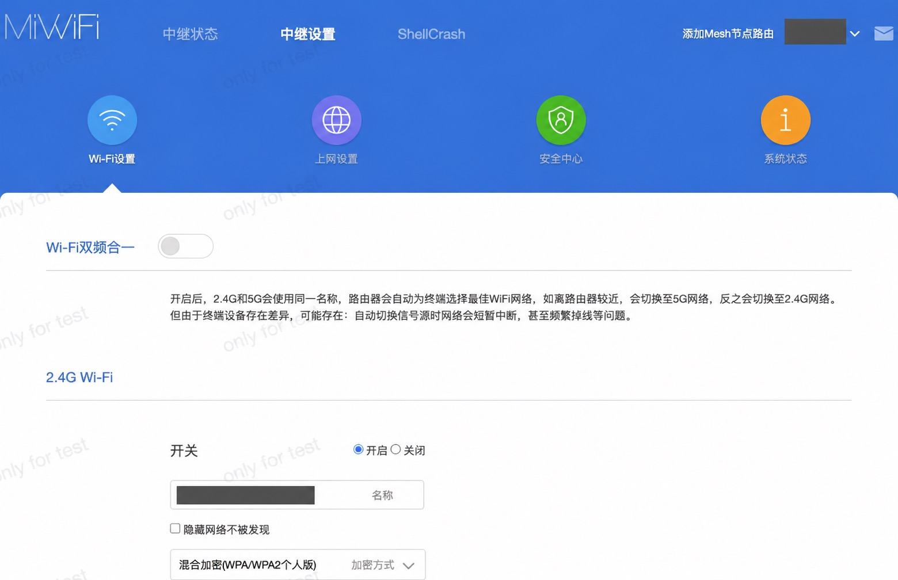
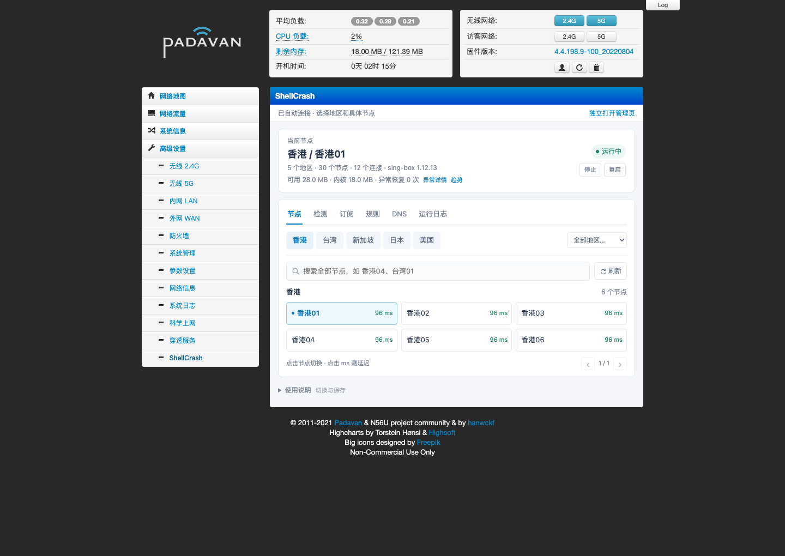

# ShellCrash Router Panel

给 ShellCrash 加一个轻量网页入口。在路由器原有后台里选节点、改分流、更新订阅、查看运行状态；需要查看完整策略组与连接时，再打开高级面板。

一份源码，分别生成 **小米 AX5** 和 **K2P / Padavan** 安装包。两种机型沿用各自的登录、启动和存储方式。路由器上不用装 Node.js、Python 或额外的网页服务。

> 当前为统一仓库候选版 `1.0.0-rc.1`，安装与恢复验收仍在进行，尚未发布稳定安装包。下面的在线命令在对应 Release 发布后使用。已有设备请保留安装前备份，使用对应升级入口；不要把源码目录直接覆盖到路由器。

## 支持哪些设备

| 项目 | 小米 AX5 | K2P |
|---|---|---|
| 已验证硬件 | Redmi AX5 / RA67，ARMv7 | K2P / MT7621，MIPSLE，16 MB 闪存 |
| 已验证固件 | 原厂开发版 **1.0.105** | Padavan **4.4.198.9-100_20220804** |
| 内核基线 | sing-box mini **1.12.13**；可切换 Mihomo **v1.19.28** | sing-box mini **1.12.13** |
| ShellCrash 基线 | **1.9.4release** | **1.9.4release** |
| 管理入口 | 小米后台顶部 ShellCrash | Padavan 高级设置 → ShellCrash |
| 配置保存 | `/data/ShellCrash/configs` | `/etc/storage/ShellCrash/configs`，写入 Storage |
| 内核保存 | 本地已校验缓存 | 默认运行在 RAM；重启后需恢复内核 |
| 守护 | procd 或每分钟检测，只开一套 | ShellCrash 原生每分钟守护 |

其他型号、其他固件以及 K2P 32 MB 改版暂未验证。机型相同不代表固件接口相同，安装脚本会检查环境后再写入。

**面板安装包不含路由器固件，也不会刷机。** 固件与面板是两件事；已运行上述固件的设备不需要为了装面板重新刷机。固件参考和核验范围见 [固件与环境](docs/FIRMWARE.md)。

## 先准备好什么

- 已开启 SSH 的路由器。AX5 使用 `root`，K2P 通常为 `admin`，以设备实际设置为准。
- 浏览器可以正常登录路由器后台。K2P 后台只允许一个管理客户端，安装或测试时退出其他管理页面。
- 电脑端安装助手需要 **Python 3.9+、OpenSSH**。macOS / Linux 可直接运行；Windows 使用 WSL。
- 在线安装时，电脑能访问 GitHub，路由器能访问 ShellCrash 内核源。访问不了时使用离线方式。
- K2P 先关闭原“科学上网”插件的运行开关，避免重复接管流量；保留其配置即可。
- 首次安装前保存固件配置。安装助手还会把本次修改前的备份存到电脑的 `~/ShellCrash-backups/`（可用 `--backup-dir` 修改），文件中可能包含私人配置，请自行保管。

AX5 安装预检要求可用内存至少 24 MB，首次安装 `/data` 剩余至少 16 MB；源码更新使用 RAM 暂存，需要 16 MB 可用内存，持久空间按最大源码文件加 256 KB 余量计算；不启动第二个内核。K2P 的 Storage 仅 512 KiB，安装和保存都要检查压缩后大小，不能按 RAM 余量判断持久空间够不够。

## 安装

先选机型，再选在线或离线方式。用户名、地址、端口都可以修改，不需要把密码写进命令。

### 在线一键部署（电脑端）

```sh
curl -fL https://raw.githubusercontent.com/wcbspp/ShellCrash-Router-Panel/main/bootstrap.py -o bootstrap.py
python3 bootstrap.py ax5 --router 192.168.31.1
```

K2P：

```sh
python3 bootstrap.py k2p --router 192.168.123.1
```

在线助手下载固定版本安装包，核对 SHA256、检查归档路径与文件，再通过 SSH 部署。SSH 密码由 OpenSSH 自己询问；K2P 首次安装的订阅输入不回显。

只想先检查环境，可以在命令末尾加 `--check-only`。自定义 SSH 端口加 `--port 22`，用户名加 `--user admin`。

### 离线一键部署（电脑端）

先在有网络的电脑上准备对应机型的安装包与固定版本内核：

```sh
python3 tools/prepare_offline.py ax5
# 或：python3 tools/prepare_offline.py k2p
```

把生成的离线目录复制到连接路由器的电脑，进入目录执行：

```sh
python3 deploy.py --router 192.168.31.1 --core-file core-offline.tar.gz
```

K2P 首次离线安装还需要本地节点文件，支持兼容的 sing-box JSON 或 AnyTLS 链接：

```sh
python3 deploy.py --router 192.168.123.1 --core-file core-offline.tar.gz --nodes-file /path/to/nodes.json
```

离线部署不会为了安装内核或读取本地节点而访问公网。K2P 安装助手先生成基础配置；若要使用服务商的完整策略和规则，安装后从配置页更新兼容的完整 sing-box 订阅。

AX5 首次离线安装保持直连，之后在面板填写订阅。K2P 的离线内核仅用于当前启动；要在重启后离线恢复，需另外配置外部持久存储，或已开启并验证的内网 WebDAV。[详细步骤](docs/DEPLOYMENT.md)

### 手动部署（路由器端）

下载并解压对应机型的 Release 包，核对 `SHA256SUMS`，将解压目录上传到路由器 `/tmp`。登录 SSH，进入安装目录。

AX5：

```sh
sh install.sh --check
sh install.sh auto
```

离线安装 AX5 时，先上传对应内核包，再执行：

```sh
SC_OFFLINE_CORE=/tmp/core-offline.tar.gz sh install.sh auto
```

K2P 需要先在电脑生成配置和管理密钥，然后上传并安装。脚本参数及恢复方法见 [手动部署](docs/DEPLOYMENT.md#手动部署)。不要随意把另一台设备的配置和密钥复制过来。

安装完成后正常登录路由器后台。面板复用后台登录权限，不另设一套网页密码。遇到未知 ShellCrash 部署、自定义启动钩子或不兼容固件时，安装助手会停止，不能通过删掉检查强行覆盖。

## 已有面板怎么更新

AX5 仍用 `deploy.py`，安装器识别本项目已有部署后更新源码。K2P 使用单独入口：

```sh
python3 update.py --router 192.168.123.1 --check-only
python3 update.py --router 192.168.123.1
```

K2P 更新先检查本项目与工具版本，下载应用备份到电脑，再覆盖源码并保存 Storage；不覆盖配置、内核或启动钩子。检查失败不强行安装。两台现用设备已完成源码升级验证；首次安装、完整恢复及全部控件验收范围见测试记录。

## 页面预览

### 小米 AX5

从小米原厂后台顶部的 **ShellCrash** 进入。原厂路由设置和轻量面板使用各自的页面，入口位置如下。



<details>
<summary>查看 AX5 轻量面板与手机版</summary>

统一项目的轻量面板：


</details>

### K2P / Padavan

从左侧 **高级设置 → ShellCrash** 进入，保留 Padavan 的导航和系统信息。下面是旧项目的后台集成布局示意，节点与数值为示例数据。



<details>
<summary>查看 K2P 当前轻量面板与手机版</summary>

统一项目实机页面：


</details>

[更多界面及截图来源](docs/SCREENSHOTS.md)。旧项目图片用于展示入口和界面演变，当前功能以统一项目的说明为准；截图数值不代表设备规格或性能保证。

## 可以做什么

| 页面 | 常用操作 |
|---|---|
| 首页 | 查看当前出口、版本、运行时长、内存、自启与守护；启动、停止、重启；切换流量模式 |
| 节点 | 按真实策略组查看成员；切换自动组或固定节点；搜索全部节点；查看协议与延迟 |
| 常用网站分流 | Google、ChatGPT、国外 AI、GitHub 分别指定组、节点或直连；四项统一保存、取消 |
| 检测 | 检查常用网站 HTTPS 响应；区分失败类型 |
| 配置 | 更新订阅、调整 User-Agent、排除节点；显示当前配置来源与下次更新参数 |
| 规则 | 查看内核实际规则、策略组和连接；添加额外域名分流 |
| DNS | 真实 DNS / Mix、Fake IP 例外、当前设置查询与保存 |
| 备份 | WebDAV 测试与保存、开关、远端最新备份、本机导出 |
| 监控与日志 | 内存趋势、保护阈值、安全清理、异常记录、操作与内核日志 |
| 高级面板 | sing-box 用 YACD，Mihomo 用 Yacd-Meta；共用当前内核与策略选择 |

页面只做管理，实际代理和自动择优由内核执行。关掉网页后，自动组照常工作。首页“停止”会同步暂停恢复，避免守护马上把服务重新拉起。

### 订阅和分流如何共用

默认从填写的原服务商地址获取订阅，由 ShellCrash 下载；工具获取失败时可以尝试同地址的面板兼容下载。直接下载不预检转换服务器，也不会自动把订阅交给第三方。

AX5 保留第三方转换方式，服务与模板默认沿用 ShellCrash 当前选择，允许覆盖。转换前先发不含订阅的预检请求；真正转换会把订阅地址交给所选服务，启用轮询可能交给多家服务。请自行判断这些服务是否可信。

K2P **只保留服务商直取与同源兼容下载**，不展示第三方转换服务或规则模板。兼容当前 sing-box 的完整 JSON 可以保留策略组、自动组、route 与受支持的 rule-set；只返回节点时使用本机基础分流。sing-box mini 不支持 SSR，不能靠更换面板解决协议支持问题。

完整配置通过校验后保留订阅策略和规则，本机 DNS、接管入口和额外域名覆盖单独保留。优先顺序是 **自定义覆盖 → 订阅规则 → 默认出口**。“跟随订阅规则”撤销覆盖；“默认代理”则是明确指定该组，含义不同。节点更新后，固定节点不存在时会按已实现的兼容策略重置到默认代理并提示，不把旧节点强塞进新配置。

模板所需资源仍受格式、版本、校验和内存预算约束。不是所有 OpenClash 模板都能直接用于这两台设备；不兼容时保留当前配置。K2P 内存不足且有同数据源的已校验缓存时可继续使用旧规则集，并明确标记“本次未更新数据”。

### 三种流量模式

- **规则分流**：新连接按当前分流规则选择出口。
- **直连上网**：撤销面板的 TCP 接管，不经代理内核转发；局域网自身的上游网络仍可能有代理。
- **全局 TCP 代理**：接管范围内的 IPv4 TCP 通过默认代理；保留局域网、管理、ZeroTier 和防循环例外。

这不是全协议 VPN。普通 UDP 与 IPv6 不包含在上述全局 TCP 保证中，不能把网站能否打开当作模式是否生效的唯一依据。切换后用新连接观察，旧连接可能继续走原出口。

### 高级面板与备份

高级面板按需下载到 RAM，重启后首次打开可能重新下载。本页打开高级面板后暂停轻量操作与测速，返回时重新读取内核选择；其他设备独立打开的面板仍可能操作同一内核。比例默认 90%，可调整，浏览器记住选择。

WebDAV 默认关闭。填写地址、账号、密码，先点“测试连接”；通过后保存开启。更换参数需要重新测试，取消勾选并保存即可关闭。关闭或未验证时，不连接远端备份。HTTP 适合可信内网，公网使用 HTTPS。

应用导出为 **`.tar.gz`**，包含应用、配置、`backup.info` 和 `RESTORE.txt`；内核单独按 SHA256 保存。K2P 下载先验证长度与 SHA256，截断内容不会被当成有效备份。导出不等于自动恢复，当前应按照包内说明人工恢复。[备份与恢复](docs/BACKUP.md)

## 上游与开发

本项目依托 [ShellCrash](https://github.com/juewuy/ShellCrash)，不替代它的终端菜单。固定的工具包、原始许可和校验记录位于 `vendor/`。

- [ShellCrash 1.9.4](https://github.com/juewuy/ShellCrash/releases/tag/1.9.4)：工具与脚本基线。
- [sing-box](https://github.com/SagerNet/sing-box)：代理内核；mini 构建来自 ShellCrash 工具源。
- [Mihomo](https://github.com/MetaCubeX/mihomo)：AX5 的另一种内核。
- [YACD](https://github.com/haishanh/yacd) / [Yacd-Meta](https://github.com/MetaCubeX/Yacd-meta)：高级面板。
- [rt-n56u](https://github.com/hanwckf/rt-n56u)：Padavan 接口参考，不代表所列固件已核实对应源码提交。
- [XMiR-Patcher](https://github.com/openwrt-xiaomi/xmir-patcher)：小米 SSH 环境参考，与面板安装分开。

```sh
python3 tools/build.py all
python3 tools/check_baseline.py
python3 tools/run_tests.py all
python3 -m unittest discover -s tests
python3 tools/package.py
```

`shared/` 放公共页面与脚本，`profiles/` 保留固件接口与能力差异。构建时只选出对应机型的代码，路由器不处理模板，不同时运行两套后端。[源码结构](docs/ARCHITECTURE.md)

上线前测试包含每个菜单、按钮、桌面和窄屏视图，以及订阅、分流、DNS、下载、备份、守护、重启和回退。自动测试通过不等于实机验收完成，执行记录分别列出通过、失败与未执行。[测试计划](docs/TEST_PLAN.md) · [控件用例](docs/CONTROL_TEST_CASES.csv) · [执行记录](docs/CONTROL_TEST_RESULTS.csv) · [当前状态](docs/TEST_STATUS.md)

GPL-3.0-only。第三方组件与商标沿用各自许可，见 [LICENSE](LICENSE)、[NOTICE](NOTICE.md)。公开包不包含私人订阅、运行配置、密码、设备身份、内核二进制或固件。
