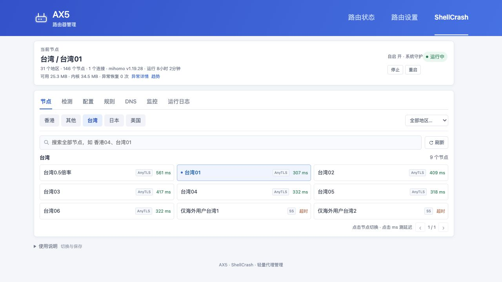

# 与旧版相比

AX5和K2P两个项目合到一个仓库，设备接口仍各走各的，公共页面和脚本统一维护。合并不代表两种机型能混用安装包。

| | 旧项目 | 统一版1.0 |
| --- | --- | --- |
| 下载与说明 | 两个仓库分别找版本 | 一个发布页，按机型选包 |
| 页面维护 | 两套源码分别改 | 公共页面共用，固件接口分开 |
| 节点列表 | 旧AX5按地区展示 | 读取实际策略组，保留各内核能力 |
| 测速 | 旧AX5多次测量后取值 | 一次内核HTTPS结果，按需另测Ping |
| 源码更新 | 旧K2P没有独立自动更新流程 | 先备份，识别已知旧版，拒绝未知修改 |
| 备份恢复 | 应用、内核和操作分散在说明里 | 完整组件检查、原生预检、二次确认与结果查询 |
| 内核升级 | 各设备分别下载和替换 | 核对实际版本和字节预算，失败回退；K2P减少压缩包与执行文件同时占内存 |
| 安装入口 | AX5路由器脚本、K2P电脑脚本 | 统一电脑向导，支持在线与离线准备 |

这是功能和维护方式的比较，不是性能排名。没有完成相同负载下的全套旧新版吞吐对比，因此不写“速度提升几倍”或“内存降低多少”。AX5的小闪存、K2P的RAM和512KiB Storage限制依然存在。

旧仓库迁移前的源码、发布附件和记录已另外备份。已有设备不用因为合并重刷固件，按[更新说明](DEPLOYMENT.md#已有面板怎么更新)处理即可。

## AX5页面变化

旧版按地区列节点：

统一版读取内核策略组：

两张是不同时间的实际页面，只比较布局与操作，不比较延迟和内存数值。
