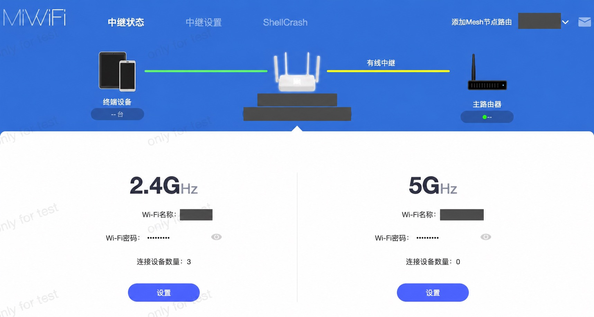

# 界面预览

## AX5：原厂后台入口

原厂开发版后台顶部新增 ShellCrash 入口。以下为旧项目已经保存的界面；当前设备原厂首页存在尚未查清的 HTTP 500，路由设置和独立面板仍可访问，这张历史截图不作为当前首页故障已修复的证明。

原厂路由状态页面

## AX5：轻量面板

当前统一项目：

旧项目的紧凑节点页面

旧版按地区展示节点，供界面演变参考；新版已经按实际策略组展示。

## K2P：Padavan 后台集成

旧项目布局示意，含示例节点和状态，用于说明 Padavan 外框、左侧菜单和内嵌页面的位置，不作为测速或实机结果证据。

当前统一项目的独立轻量面板：

## 手机页面

## 图片来源

| 图片 | 来源 | 用途 |
|---|---|---|
| AX5 原厂设置、路由状态 | 旧 XiaoMiAX5-shellcrash-panel 项目保存图片 | 原厂后台入口与历史界面 |
| AX5 旧节点页 | 同一旧项目 | 界面演变参考 |
| K2P Padavan 外框 | 旧 K2P-Padavan-shellcrash-panel 的布局示意 | 后台集成方式 |
| 两机当前桌面和手机页 | 统一项目实机测试记录 | 当前轻量页面 |

旧图片保持原文件内容。原厂图片中的私人信息已遮盖；没有把示例数据和历史界面当成当前实机验收结果。
